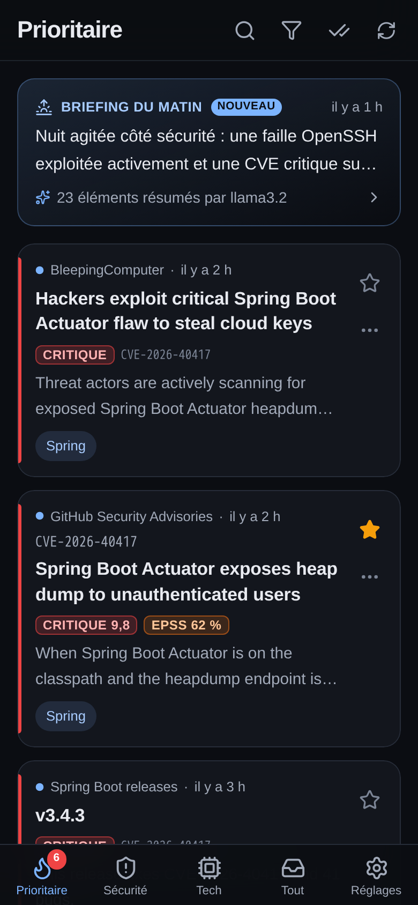
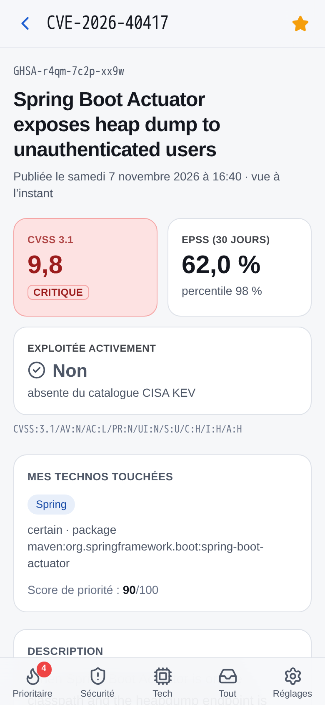
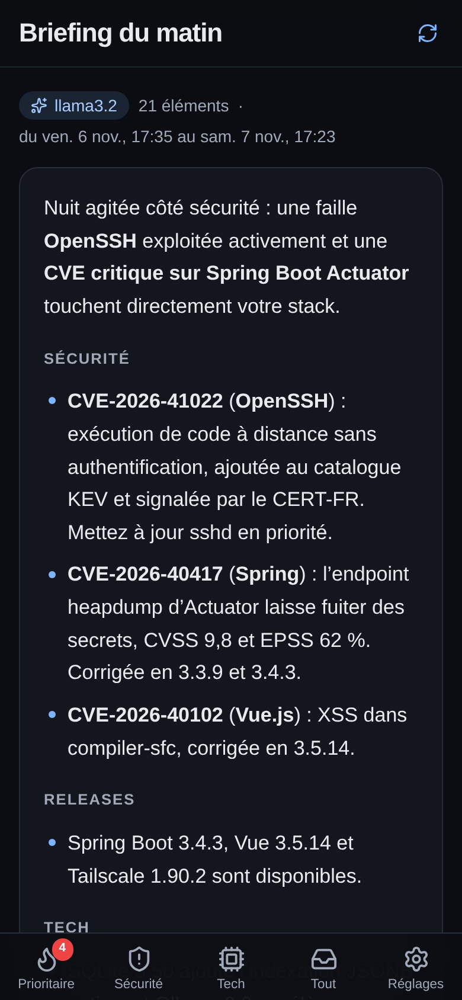
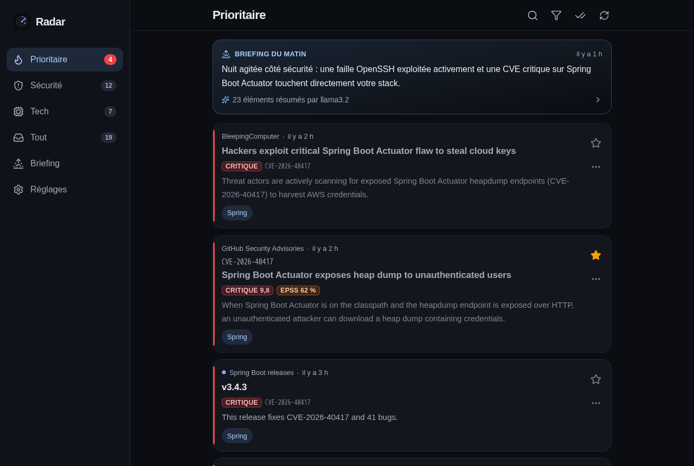

# Radar

Lecteur RSS auto-hébergé de **veille sécurité et tech**, mono-utilisateur, pensé pour le téléphone (PWA) et accessible uniquement via **Tailscale**.

Radar agrège flux RSS/Atom et sources JSON (CISA KEV, GitHub Advisory Database), déduplique, fusionne toutes les mentions d'une même CVE en **une fiche** (enrichie par NVD et EPSS), la rapproche de **votre watchlist de technos** et calcule un **score de priorité**. Vous ne recevez une notification que quand ça en vaut la peine, et chaque matin un **briefing** rédigé par une IA locale (Ollama) résume tout ce qui est arrivé depuis la veille.

| Prioritaire (iPhone, sombre) | Fiche CVE (iPhone, clair) | Briefing du matin | Desktop |
|---|---|---|---|
|  |  |  |  |

Toutes les captures (iPhone 390×844 et desktop, thèmes sombre et clair) sont dans [`docs/screenshots/`](docs/screenshots/).

---

## Sommaire

1. [Installation](#1-installation)
2. [Variables d'environnement](#2-variables-denvironnement)
3. [Accès HTTPS avec `tailscale serve`](#3-accès-https-avec-tailscale-serve)
4. [Installer la PWA (iPhone, Android)](#4-installer-la-pwa)
5. [Activer les notifications](#5-activer-les-notifications)
6. [Ajouter une techno à la watchlist](#6-ajouter-une-techno-à-la-watchlist)
7. [IA locale : résumés et briefing du matin (Ollama)](#7-ia-locale--résumés-et-briefing-du-matin-ollama)
8. [Sauvegarder le volume `./data`](#8-sauvegarder-le-volume-data)
9. [Fonctionnement : score, règles de notif, sources](#9-fonctionnement)
10. [Développement](#10-développement)
11. [Dépannage](#11-dépannage)

---

## 1. Installation

Prérequis : un serveur Linux (Ubuntu Server par exemple) avec Docker, Docker Compose et Tailscale.

```bash
git clone https://github.com/Whiplashhhh/Radar.git
cd Radar
cp .env.example .env          # puis ajustez si besoin (voir §2)
mkdir -p data
docker compose up -d --build
docker compose ps             # le statut doit passer à « healthy »
curl http://127.0.0.1:8787/health
```

- Le conteneur **n'écoute que sur `127.0.0.1:${PORT}`** côté hôte (`ports: "127.0.0.1:8787:8787"`). Rien n'est exposé sur le réseau local ni sur Internet.
- Au premier démarrage, Radar crée `data/radar.db` (SQLite), génère les clés VAPID du push dans `data/vapid.json`, puis charge les **flux par défaut** et la **watchlist initiale**. La collecte démarre aussitôt.
- Mise à jour : `git pull && docker compose up -d --build`. Les migrations de base sont appliquées automatiquement au démarrage.
- Logs JSON (pino) : `docker compose logs -f radar`.

## 2. Variables d'environnement

| Variable | Défaut | Rôle |
|---|---|---|
| `PORT` | `8787` | Port HTTP (publié sur `127.0.0.1` uniquement). |
| `VAPID_SUBJECT` | `mailto:radar@localhost` | Contact transmis aux services push. Mettez une adresse `mailto:` réelle. |
| `NVD_API_KEY` | — | Clé API NVD (facultative). Sans clé : 5 requêtes / 30 s. Avec : 50 / 30 s. [Demander une clé](https://nvd.nist.gov/developers/request-an-api-key). |
| `GITHUB_TOKEN` | — | Token GitHub sans droits (facultatif) : relève la limite de l'API Advisories de 60 à 5 000 requêtes/h. |
| `OLLAMA_URL` | — | URL d'Ollama (ex. `http://host.docker.internal:11434`). Vide = IA désactivée. |
| `OLLAMA_MODEL` | `llama3.2` | Modèle utilisé pour les résumés et le briefing. |
| `ALLOW_PRIVATE_NETWORKS` | `false` | Autorise les flux hébergés sur des IP privées ou locales (LAN, tailnet). Désactivé par défaut (protection SSRF). |
| `LOG_LEVEL` | `info` | `debug`, `info`, `warn`, `error`. |
| `TZ` / `APP_TZ` | `Europe/Paris` | Fuseau horaire (heures calmes, digest, briefing). |
| `FETCH_TIMEOUT_MS` | `20000` | Timeout d'un fetch de flux. |
| `FETCH_MAX_BYTES` | `10485760` | Taille maximale d'une réponse (10 Mo). |
| `DATA_DIR` | `/data` | Dossier des données dans le conteneur (monté depuis `./data`). |

## 3. Accès HTTPS avec `tailscale serve`

Le service worker, l'installation PWA et le push **exigent HTTPS**. Tailscale fournit un certificat valide pour le nom MagicDNS de la machine.

1. Dans la console d'admin Tailscale (**DNS**), activez **MagicDNS** et **HTTPS Certificates**.
2. Sur le serveur :

   ```bash
   sudo tailscale serve --bg --https=8443 http://127.0.0.1:8787
   ```

3. Ouvrez `https://<machine>.<tailnet>.ts.net:8443/` depuis un appareil du tailnet.

- **Adaptez le port HTTPS** (`--https=8443`) s'il est déjà pris sur la machine, par un autre `tailscale serve` par exemple. Si le port 443 est libre, `--https=443` donne une URL sans port.
- Pour vérifier : `tailscale serve status`. Pour arrêter : `sudo tailscale serve --https=8443 off`.
- N'utilisez **pas** `tailscale funnel`, qui exposerait Radar sur Internet. Radar n'a pas d'authentification applicative : la sécurité repose sur le tailnet.

## 4. Installer la PWA

### iPhone / iPad (iOS 16.4 ou plus récent)

Sur iOS, **les notifications push ne fonctionnent que si l'app est installée sur l'écran d'accueil.**

1. Ouvrez l'URL `https://…ts.net:8443` dans **Safari**.
2. Touchez **Partager** (le carré avec une flèche), puis **Sur l'écran d'accueil**, puis **Ajouter**.
3. Lancez **Radar depuis l'icône** : l'app s'ouvre en plein écran.

Si vous ouvrez Radar dans Safari sans l'avoir installée, une bannière et l'écran *Réglages → Notifications* vous guident vers ces étapes.

### Android (Chrome)

1. Ouvrez l'URL dans **Chrome**.
2. Menu **⋮**, puis **Installer l'application** (ou *Ajouter à l'écran d'accueil*).

### Desktop

Chrome et Edge proposent **Installer Radar** dans la barre d'adresse. Radar s'utilise aussi très bien dans un simple onglet : la navigation passe alors par un rail latéral.

## 5. Activer les notifications

1. Dans l'app installée, allez dans **Réglages → Notifications sur cet appareil → Activer les notifications**. La permission n'est demandée qu'à ce clic, jamais au chargement (exigence iOS).
2. Touchez **Envoyer une notif de test** : elle doit arriver en quelques secondes.
3. Répétez sur chaque appareil (iPhone, Android, desktop) : chaque appareil a son propre abonnement. Les abonnements expirés (404/410) sont supprimés automatiquement.

**Ce qui déclenche une notification** (modifiable dans *Réglages*) :

- **Immédiat** : une CVE qui touche votre watchlist **et** remplit au moins une condition parmi CVSS ≥ 9, présence au catalogue KEV (exploitée activement) ou EPSS ≥ 30 %. Les **alertes CERT-FR** déclenchent aussi une notif immédiate.
- **Le matin** (08:00 par défaut) : une seule notif qui réunit le **briefing** et le **digest**, c'est-à-dire les CVE matchées de sévérité moyenne ou haute et le top des actus.
- **Rien** pour le reste, qui reste consultable dans le fil.

Plusieurs règles limitent le bruit :

- **Heures calmes** (22:00–07:00 par défaut) : les notifs non critiques sont décalées à la fin de la plage. Sont critiques les vulns KEV ou de CVSS ≥ 9 sur une techno matchée de façon certaine.
- **Anti-rafale** : les alertes qui arrivent ensemble sont regroupées en une seule notif (« 4 nouvelles CVE critiques »), avec au plus une notif toutes les 5 min.

Chaque notification **se suffit à elle-même** : titre, sévérité et techno touchée sont dans le message. Vous la recevez donc même hors du tailnet, car elle transite par les services push d'Apple ou Google. **Toucher la notification** ouvre directement la fiche CVE dans l'app, ce qui demande d'être sur le tailnet. Le compteur de l'icône (Badging API) indique le nombre d'éléments prioritaires non lus.

> Le serveur doit pouvoir joindre Internet en sortie (`web.push.apple.com`, `fcm.googleapis.com`…) pour envoyer les notifications.

## 6. Ajouter une techno à la watchlist

Allez dans **Réglages → Watchlist des technos → +**.

| Champ | Exemple | Effet |
|---|---|---|
| Nom | `Gitea` | Affiché sur les cartes (chip). |
| Alias / mots-clés | `Gitea`, `Forgejo` | Cherchés dans les titres et textes avec des **frontières de mot**. Le match est **« probable »**. Préfixez par `=` pour respecter la casse : `=React` ne matche pas « users react to… ». |
| Packages | `go:code.gitea.io/gitea`, `npm:@vue/*` | Comparés aux packages des advisories GitHub. Le match est **« certain »**. Le joker `*` est accepté. Écosystèmes : `npm`, `maven`, `pip`, `pub`, `go`, `rubygems`, `nuget`, `composer`, `rust`. |
| CPE | `gitea:gitea` | `vendor:product` du dictionnaire NVD. Le match est **« certain »**. |
| Exclusions | `Docker Desktop` | Annulent un match probable (faux positifs). |

À l'enregistrement, Radar recalcule les matchs et les scores des 60 derniers jours. Un match **certain** passe par un identifiant structuré (package ou CPE), un match **probable** seulement par un mot-clé. Pour trouver un CPE, cherchez le produit sur [nvd.nist.gov/products/cpe/search](https://nvd.nist.gov/products/cpe/search). Le CPE s'écrit `cpe:2.3:a:<vendor>:<product>:…`, et vous ne gardez que `vendor:product`.

## 7. IA locale : résumés et briefing du matin (Ollama)

Radar fonctionne entièrement sans IA. Avec [Ollama](https://ollama.com), il ajoute :

- un **résumé de 2 lignes en français** pour les articles longs et les fiches CVE (✨ dans le fil) ;
- un **briefing du matin** : à l'heure du digest, le modèle rédige une synthèse de **toutes les actus reçues depuis le briefing précédent**. Il commence par une phrase d'accroche, puis des sections Sécurité, Releases, Tech et Actus, avec les CVE qui touchent vos technos mises en avant. Aucun briefing n'est généré s'il n'y a pas eu d'actus. Sans Ollama, ou si Ollama ne répond pas, Radar produit un briefing **sans IA** (meilleurs titres par section) pour que l'écran ne soit jamais vide.

### Mise en place avec Ollama sur l'hôte

```bash
# 1. Ollama doit écouter sur une interface joignable depuis Docker
sudo systemctl edit ollama
#   [Service]
#   Environment="OLLAMA_HOST=0.0.0.0:11434"
sudo systemctl restart ollama

# 2. Téléchargez un modèle (un modèle de 3 à 8 B suffit ; qwen2.5:7b ou mistral sont bons en français)
ollama pull llama3.2

# 3. Dans .env
OLLAMA_URL=http://host.docker.internal:11434
OLLAMA_MODEL=llama3.2

docker compose up -d
```

Si Ollama tourne dans un autre conteneur du même réseau Docker, utilisez son nom de service : `OLLAMA_URL=http://ollama:11434`. Assurez-vous que le port 11434 n'est pas exposé sur Internet (pare-feu).

Vérifiez dans **Réglages → IA locale (Ollama)** que le statut est **Opérationnel**, puis touchez **Générer un briefing maintenant**. L'heure du briefing se règle dans **Réglages → Le matin**, et les briefings passés sont dans l'onglet **Briefing** (desktop) ou accessibles via la bannière en haut de *Prioritaire*.

## 8. Sauvegarder le volume `./data`

`./data` contient **tout l'état** :

- `radar.db`, plus `radar.db-wal` et `radar.db-shm` (base SQLite en mode WAL) : flux, items, fiches, watchlist, réglages, abonnements push ;
- `vapid.json` : clés du push. **Si vous les perdez, tous les appareils devront réactiver les notifications.**

**Sauvegarde à froid** (la plus simple) :

```bash
docker compose stop radar
tar czf ~/backups/radar-$(date +%F).tgz data
docker compose start radar
```

**Sauvegarde à chaud** (sans arrêt, avec `sqlite3` installé sur l'hôte) :

```bash
sqlite3 data/radar.db ".backup '$HOME/backups/radar-$(date +%F).db'"
cp data/vapid.json ~/backups/
```

Pour automatiser, ajoutez par exemple cette ligne au cron de l'hôte (`crontab -e`) :
`15 3 * * * cd /opt/Radar && sqlite3 data/radar.db ".backup '/backups/radar-$(date +\%u).db'" && cp data/vapid.json /backups/`

**Restauration** : arrêtez le conteneur, remettez `radar.db` et `vapid.json` dans `data/` (supprimez les éventuels `-wal`/`-shm` restants), puis relancez.

## 9. Fonctionnement

### Sources

| Catégorie | Sources par défaut |
|---|---|
| Sécurité | CERT-FR (alertes et avis), CISA KEV, GitHub Security Advisories (maven, npm, pip, pub), BleepingComputer, The Hacker News, Krebs on Security, Zataz |
| Tech | Hacker News (via hnrss.org, seuil de points réglable), LWN.net, Next |
| Actus | Ars Technica, Korben |
| Releases | GitHub `releases.atom` : Spring Boot, Vue.js, React, Node.js, Flutter, Docker (Moby), Tailscale, Immich, n8n, Ollama, Pi-hole |

La gestion des flux se fait dans **Réglages → Flux** : ajout par URL avec auto-découverte depuis une page HTML, catégorie, intervalle, activation, import et export **OPML**, et **santé des flux** (dernier relevé, nombre d'erreurs, dernière erreur). La collecte respecte `ETag` et `If-Modified-Since`, avec un backoff exponentiel en cas d'erreur, un timeout et une taille maximale. `npm run check:feeds` vérifie que chaque URL du seed répond.

### Score de priorité (0–100)

| Vuln | Points |
|---|---|
| Sévérité CVSS | critique 40 · haute 30 · moyenne 15 · basse 5 · inconnue 10 |
| Exploitée (KEV) | +25 |
| EPSS | ≥ 50 % : +20 · ≥ 10 % : +12 · ≥ 1 % : +5 |
| Watchlist | certain +30 · probable +15 |

Pour un article, le score part de la catégorie (sécurité 20, releases 15, tech 10, actus 5), auquel s'ajoutent le bonus du flux (CERT-FR alertes +50) et le match watchlist (certain +25, probable +10). Il vaut au minimum (meilleure CVE citée − 10). L'onglet **Prioritaire** affiche les éléments de score ≥ 60, seuil réglable. Le détail est dans [`SPEC.md`](SPEC.md) et testé dans `server/test/scoring.test.ts`.

### Interface

- Onglets **Prioritaire**, **Sécurité**, **Tech**, **Tout** et **Réglages**. Thème sombre par défaut, thème clair disponible.
- Gestes : glisser à droite pour marquer lu ou non lu, à gauche pour mettre en favori. **Tirer vers le bas** rafraîchit. Le menu **…** d'une carte propose « Tout marquer lu jusqu'ici ».
- Recherche plein texte (SQLite FTS5, insensible aux accents) et filtres par source, techno, sévérité, lu/non lu et favoris.
- Mode lecture épuré (Readability côté serveur) avec lien vers l'original.
- **Hors-ligne** : les derniers items, les favoris et les fiches consultées restent lisibles (cache du service worker).
- Rétention : les éléments lus de plus de N jours (30 par défaut) sont purgés chaque jour, sauf les favoris et les fiches CVE matchées.

### Sécurité

- Pas d'authentification applicative : l'accès est limité au tailnet, et le conteneur n'écoute que sur `127.0.0.1`.
- CSP stricte (`default-src 'self'`, pas de script ni de style inline, `frame-ancestors 'none'`), `X-Content-Type-Options: nosniff`, `Referrer-Policy: no-referrer`.
- HTML des flux et des pages **assaini côté serveur** (sanitize-html) : pas de script, d'iframe ni d'attribut d'événement.
- **Anti-SSRF** : les fetchs refusent les IP privées, loopback, link-local, CGNAT (dont les adresses Tailscale `100.64.0.0/10`), ULA et multicast. Le contrôle a lieu à la résolution DNS et à chaque redirection (suivie manuellement). Il se lève avec `ALLOW_PRIVATE_NETWORKS=true`.

## 10. Développement

Prérequis : Node.js 22+.

```bash
npm install
npm run dev              # API (tsx watch, :8787) + Vite (:5173, proxy /api)
npm run lint             # ESLint
npm run typecheck        # tsc serveur + web
npm test                 # Vitest : parsing, matching, scoring, dédup, notifs, API…
npm run build            # web/dist + dist/server
npm run test:e2e         # Playwright (iPhone 390×844 + desktop) sur une base de démo, captures dans docs/screenshots
npm run demo:seed -- ./data-demo   # base de démonstration déterministe
npm run check:feeds      # vérifie les URL du seed
```

Arborescence :

```
server/src/
  adapters/   rss (RSS/Atom/RDF), cisa-kev, github-advisories, nvd, epss
  core/       matching, scoring, dédup, extraction CVE/GHSA, OPML, découverte, Readability
  services/   pipeline (ingestion, fusion), poller, enricher, notifier, push, briefing, ollama, scheduler, retention
  routes/     API Fastify
  db/         schéma Drizzle (migrations dans drizzle/)
web/src/      React + Tailwind, service worker (sw.ts)
e2e/          tests Playwright
```

La CI (GitHub Actions) enchaîne lint, typecheck, tests, build, e2e Playwright et build de l'image Docker. Elle se termine par `docker compose up` avec vérification du healthcheck et du port lié à `127.0.0.1`. Le workflow `feeds.yml` (manuel et hebdomadaire) vérifie les URL des flux.

Spécification : [`SPEC.md`](SPEC.md) · Plan : [`PLAN.md`](PLAN.md) · Choix techniques : [`DECISIONS.md`](DECISIONS.md).

## 11. Dépannage

| Symptôme | Piste |
|---|---|
| Le bouton « Activer les notifications » renvoie vers l'écran d'installation | Sur iPhone, ouvrez Radar **depuis l'icône** de l'écran d'accueil, pas depuis Safari. |
| « Permission refusée » | Réautorisez Radar : *Réglages iOS → Notifications → Radar*, ou les paramètres du site dans Chrome. |
| Aucune notif de test reçue | `docker compose logs radar \| grep push` : le serveur doit joindre les services push en sortie. |
| Un flux est en erreur | *Réglages → Flux* : ouvrez-le pour voir la dernière erreur. Un backoff exponentiel s'applique (24 h maximum), et **Relever** force un nouvel essai. |
| Un flux sur le LAN est refusé | Comportement normal (protection SSRF). Mettez `ALLOW_PRIVATE_NETWORKS=true` si vous en avez besoin. |
| Ollama « Injoignable » | Vérifiez `OLLAMA_HOST=0.0.0.0` côté Ollama et `OLLAMA_URL=http://host.docker.internal:11434`. Testez avec `docker compose exec radar node -e "fetch(process.env.OLLAMA_URL+'/api/tags').then(r=>r.text()).then(console.log)"`. |
| Les CVE n'ont pas de score CVSS | L'enrichissement NVD est limité à 5 requêtes / 30 s sans clé. Ajoutez `NVD_API_KEY`. |
